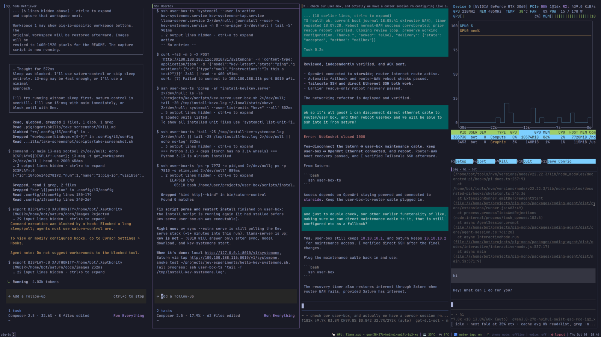
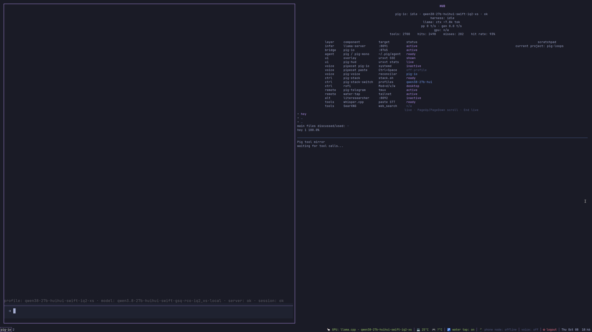
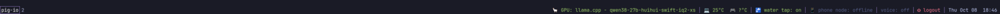
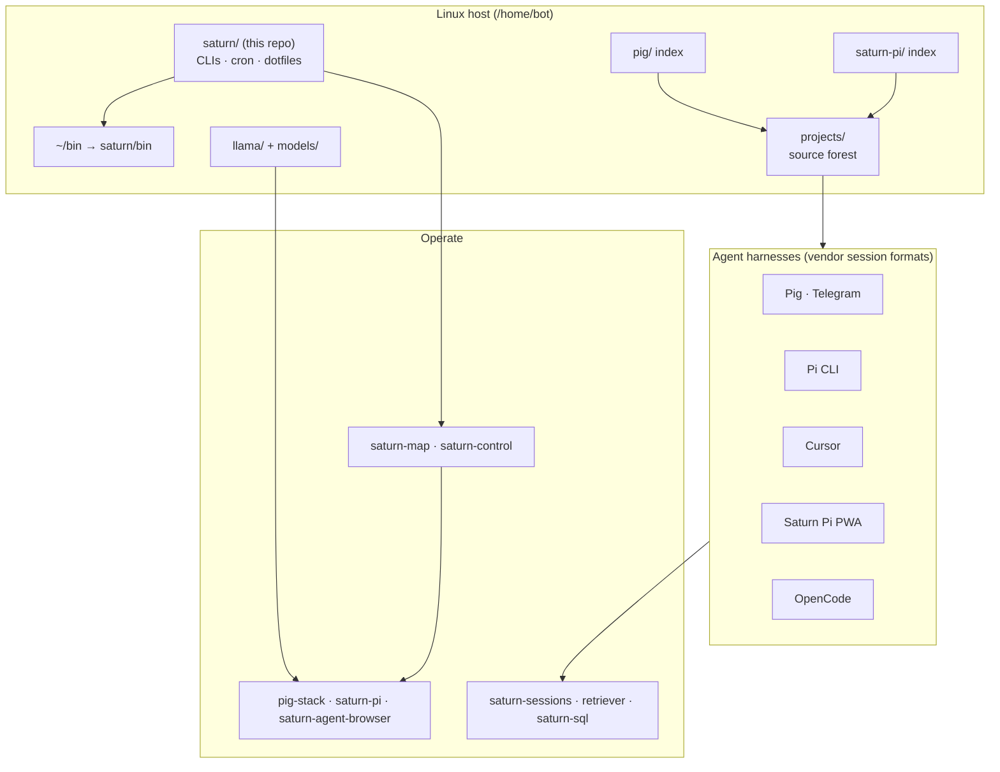

# Saturn

| Desktop (current workspace) | Workspace **`1:pig-io`** (Pig HUD) |
|:---:|:---:|
|  |  |



> **Saturn is an AI system** — not a hostname, not dotfiles for dotfiles' sake.  
> linux-as-a-harness | os agent harness  
> it's basically ubuntu w bunch of bash scripts that serve as an agent control plane.  
> if codex is the inner, openclaw is the middle, then saturn is the outer. i use it as a thought organization tool.  
> it has all the basics: llama/ for inference, bin for the saturn bash scripts, saturn cron, dotfiles, systemd.  
> and some agent basics: session management, a2a, works with any harness, model recipe's, inference engines, gpu management, computer/browser use, and more  
> it's a good starting place to build our an ai system. i kept it as unix-y as i could and tried to stay true to the Dennis's's.  
> saturn UX is agent-human interface. it's competely word and language driven.  
> Owner-operated **multi-harness agents**, **local inference & voice**, **mobile & phone nodes**, and a **Unix control surface** (`saturn-*`, `pig-stack`) on one Linux host.

| | |
|---|---|
| **This repo** | Host **spine**: conventions, `~/bin` → `saturn/bin`, cron/systemd, dotfiles, cross-harness tool map |
| **The full system** | Many git repos under `projects/`, plus on-disk indexes (`pig/`, `saturn-pi/`, `llama/`), weights, and harness session stores |

**Docs:** [Agent tools](SATURN_AGENT_TOOLS.md) · [Conventions](SATURN_CONVENTIONS.md) · [Core sources](CORE_SOURCES.md) · [Filesystem mental map](human-mental-map-saturn-fs-and-operation.md)

**Sessions:** `saturn-sessions` is **0.2** — read-only desktop Pi/Pig snapshot (`list`, aliases). Transcript search/read: `saturn-ai-convo-retreiver` · project `/home/bot/projects/saturn-sessions/`.

---

## How the pieces fit



**Integration rule:** Saturn **indexes** transcripts where harnesses already write them; it **composes** small CLIs. It does not become the sole git home for the stack or replace vendor on-disk formats.

---

## System map

```text
/home/bot/
├── saturn/              ← you are here (git): conventions, saturn-* CLIs, cron, dotfiles
├── bin → saturn/bin     one-deep command surface on PATH
│
├── pig/                 Pig operational index  →  pig-mono, pig-io, voice
├── saturn-pi/           Saturn Pi index        →  PWA / app source
├── llama/               inference platform     →  llama-server integration
├── models/              GGUF weights (runtime artifacts, not app source)
│
├── projects/            many independent repos (pig-io, saturn-pi, saturn-sql, vendor/…)
├── tools/               installed SDKs / runtimes
│
└── runtime session roots (typical)
    ├── .pig/agent/sessions/
    ├── .pi/agent/sessions/
    ├── .cursor/projects/
    ├── .local/share/saturn-pi-pwa/sessions/
    ├── .local/share/opencode/
    └── .local/state · share · cache/   (XDG — Saturn-owned audit & app state)
```

Pointers between indexes: `CORE_SOURCES.md` in `saturn/`, `pig/`, and `saturn-pi/`. Discovery on the machine: `saturn-map <need-or-command>`.

---

## Component catalog

| Layer | Role | Lives at | Operate with |
|:------|:-----|:---------|:-------------|
| **Host overlay** | Cross-harness tools, scheduling, norms | `saturn/`, `~/bin` | `SATURN_*` docs, `saturn-control`, `saturn-sessions`, `saturn-sql` |
| **Pig stack** | GPU voice + Pig agent host | `pig/` → `projects/pig-mono`, `pig-io`, `pipecat-voice-router` | `pig-stack` |
| **Pi** | Pi CLI sessions | `projects/vendor/pi-mono` | `pi` |
| **Saturn Pi** | iPhone PWA control surface | `saturn-pi/` → `projects/saturn-pi` | `saturn-pi` |
| **Inference** | Local models & profiles | `llama/`, `models/`, `~/.config/pig-stack/` | recipes, rofi / profile switcher |
| **Visual browser agent** | HDMI browser + VLM worker | `projects/saturn-agent-browser` | `saturn-agent-browser` |
| **Phone node** | Android cam / mic / HUD | `projects/android-ai-phone-app` | `phone-node`, `phone-node-cam`, `phone-node-hud` |
| **Session corpus** | All harness history (read/index) | paths above | `saturn-ai-convo-retreiver`, `saturn-sql` |
| **Adjunct** | RAG, travel, monitoring, mail | various `projects/*` | project CLIs (`saturn-travel-supernova`, …) |

---

## What lives in *this* git repo

Shell CLIs in `bin/`, user `dotfiles/`, `cron/` + `systemd/` schedules, and reference markdown — the **control plane and textbook** for the wider system. Implementation code for Pig, Saturn Pi, SQL adapters, and most features is **out of tree** under `projects/` (see [CORE_SOURCES.md](CORE_SOURCES.md)).

There is **no** `saturn harness` mega-binary. Planes are separate tools; see [SATURN_AGENT_TOOLS.md](SATURN_AGENT_TOOLS.md).
